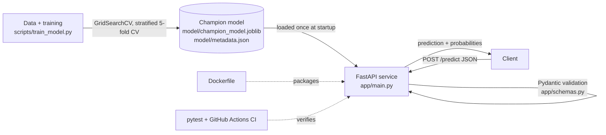

# Real-Time ML Inference API

A production-style REST microservice that serves a trained **champion model** (tuned Random Forest) for real-time classification. Built with **FastAPI**, containerized with **Docker**, and covered by automated **pytest** tests and CI.

- **Task:** binary classification on the Wisconsin Breast Cancer dataset (30 numeric features) — `0 = malignant`, `1 = benign`
- **Champion model:** Random Forest, selected from Logistic Regression / Random Forest / XGBoost / LightGBM via GridSearchCV + stratified 5-fold CV on ROC-AUC (see `model/metadata.json` for the exact metrics)

## Architecture



**Request flow:** JSON body → Pydantic schema validation (exactly 30 finite floats, else `422`) → DataFrame with the training feature names → `predict_proba` → JSON response with class, label, confidence and per-class probabilities.

**Design decisions**
- Model is loaded **once** at startup (FastAPI lifespan), not per request, for low latency.
- Strict input validation rejects malformed, wrong-length, non-numeric or non-finite input before it reaches the model.
- Dependencies are **pinned** (`requirements.txt`) because a pickled scikit-learn model must be loaded with the same version it was trained with.
- Container runs as a **non-root user** and includes a `HEALTHCHECK`.

## Repository layout

```
app/                 FastAPI app (main.py) and Pydantic schemas (schemas.py)
model/               champion_model.joblib + metadata.json (feature names, classes, metrics)
scripts/train_model.py   reproduces the model
tests/test_api.py    unit tests (schema, status codes, correctness)
Dockerfile           pinned, slim, non-root image
requirements*.txt    pinned runtime / dev dependencies
.github/workflows/   CI: run tests, build image
sample_request.json  example payload
```

## Run locally

```bash
python -m venv .venv && source .venv/bin/activate      # Windows: .venv\Scripts\activate
pip install -r requirements-dev.txt
uvicorn app.main:app --reload
```
Interactive docs (Swagger UI): http://127.0.0.1:8000/docs  ·  ReDoc: http://127.0.0.1:8000/redoc

## Run with Docker

```bash
docker build -t ml-inference-api .
docker run --rm -p 8000:8000 ml-inference-api
```

## API documentation

### `POST /predict`
Predict the class for one sample.

**Request**
```json
{"features": [17.99, 10.38, 122.8, 1001.0, 0.1184, 0.2776, 0.3001, 0.1471, 0.2419, 0.07871,
              1.095, 0.9053, 8.589, 153.4, 0.006399, 0.04904, 0.05373, 0.01587, 0.03003, 0.006193,
              25.38, 17.33, 184.6, 2019.0, 0.1622, 0.6656, 0.7119, 0.2654, 0.4601, 0.1189]}
```
`features` must contain exactly 30 finite numbers, in the order given by `GET /model-info`.

**Response `200`**
```json
{
  "prediction": 0,
  "label": "malignant",
  "confidence": 0.955214,
  "probabilities": {"malignant": 0.955214, "benign": 0.044786}
}
```

| Status | Meaning |
|-------:|---------|
| 200 | Prediction returned |
| 422 | Invalid payload (missing/extra/non-numeric features, wrong length, malformed JSON) |
| 405 | Wrong HTTP method (e.g. `GET /predict`) |
| 503 | Model not loaded |

**curl**
```bash
curl -X POST http://127.0.0.1:8000/predict -H "Content-Type: application/json" -d @sample_request.json
```
**Python**
```python
import requests, json
r = requests.post("http://127.0.0.1:8000/predict", json=json.load(open("sample_request.json")))
print(r.json())
```

### `GET /health`
Liveness/readiness probe → `{"status": "ok", "model_loaded": true}`

### `GET /model-info`
Model type, number of features, ordered feature names, class mapping, and CV/test ROC-AUC.

## Tests

```bash
pytest -v
```
16 tests cover: health and model-info endpoints; response schema and `200` status; probabilities summing to 1; known malignant and benign samples; confidence consistency; deterministic output; and `422` for missing, short, long, wrongly typed, null, wrongly keyed, `NaN` and malformed-JSON payloads; plus `405`/`404` handling.

## Retraining

```bash
python scripts/train_model.py     # rewrites model/champion_model.joblib and model/metadata.json
```
If you retrain with different library versions, update `requirements.txt` to match.

## Limitations / next steps
Single-sample endpoint (batch endpoint would be a simple extension); no authentication or rate limiting; model is trained on a small public dataset and is for demonstration only, not clinical use. Natural next steps: batch `/predict`, model versioning, Prometheus metrics, and deployment to a cloud service.
